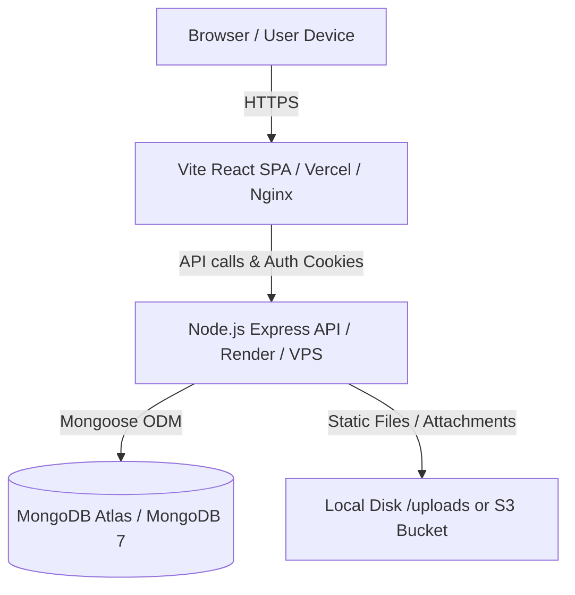

# FoodKind Deployment Guide

This guide details the complete deployment lifecycle for the **FoodKind** platform across both cloud-native managed providers (Vercel, Render, MongoDB Atlas) and self-hosted Linux VPS setups with Docker.

---

## 1. System Architecture



- **Frontend**: Vite + React 18 SPA (Vanilla CSS design system, Lucide icons, Leaflet maps, Recharts).
- **Backend**: Node.js + Express (ES Modules), JWT cookie session authentication, CSRF guard (`X-Requested-With`), Multer uploads.
- **Database**: MongoDB 7.0+ (Atlas cloud or local Docker instance).

---

## 2. Option A: Managed Cloud Deployment (Recommended & Free Tier Friendly)

### Step 1: Set up MongoDB Atlas (Cloud Database)
1. Go to [MongoDB Atlas](https://www.mongodb.com/cloud/atlas) and create a free M0 cluster.
2. In **Database Access**, create a database user (e.g., `foodkind_admin`) with a secure password.
3. In **Network Access**, add an IP Access Entry: `0.0.0.0/0` (Allow access from anywhere) so your backend server can connect.
4. Click **Connect** → **Drivers (Node.js)** and copy your connection string:
   ```env
   mongodb+srv://foodkind_admin:<password>@cluster0.abcde.mongodb.net/foodkind?retryWrites=true&w=majority
   ```

---

### Step 2: Deploy Backend (Render.com / Railway)

1. Push your repository to GitHub or GitLab.
2. Log into [Render.com](https://render.com) and click **New +** → **Web Service**.
3. Select your repository:
   - **Root Directory**: `backend`
   - **Build Command**: `npm ci`
   - **Start Command**: `npm start`
   - **Environment**: `Node`
4. Under **Environment Variables**, configure:

| Variable | Recommended Value | Note |
| :--- | :--- | :--- |
| `NODE_ENV` | `production` | Enables strict cookies & production logging |
| `PORT` | `5050` | Or auto-assigned port |
| `MONGODB_URI` | `mongodb+srv://...` | Your MongoDB Atlas connection URI |
| `JWT_SECRET` | *(64-char random string)* | Used to sign auth JWTs |
| `COOKIE_SECRET` | *(64-char random string)* | Used for cookie parsing |
| `CORS_ORIGIN` | `https://your-foodkind-frontend.vercel.app` | Your frontend production URL |
| `UPLOAD_DIR` | `uploads` | Local upload directory |
| `MAX_UPLOAD_SIZE_MB` | `10` | Max file upload limit |

5. Click **Deploy Web Service**.
6. Note your backend URL (e.g. `https://foodkind-api.onrender.com`).

---

### Step 3: Deploy Frontend (Vercel / Netlify)

1. Log into [Vercel](https://vercel.com) and click **Add New** → **Project**.
2. Select your repository:
   - **Root Directory**: `frontend`
   - **Framework Preset**: `Vite`
   - **Build Command**: `npm run build`
   - **Output Directory**: `dist`
3. Under **Environment Variables**, add:
   ```env
   VITE_API_BASE_URL=https://foodkind-api.onrender.com/api/v1
   ```
4. Click **Deploy**.
5. Once deployed, copy your frontend domain (e.g. `https://foodkind.vercel.app`) and ensure it matches the `CORS_ORIGIN` in your backend environment variables!

---

## 3. Option B: Self-Hosted Docker Deployment (Single Server / VPS)

For deploying on AWS EC2, DigitalOcean Droplet, Linode, or Hetzner:

### Prerequisites on Server:
- Docker Engine 24+ & Docker Compose v2.

### Step-by-Step:
1. Clone the project onto your server:
   ```bash
   git clone <your-repo-url> foodkind
   cd foodkind
   ```
2. Inspect or customize `docker-compose.yml`:
   - Adjust `JWT_SECRET` and `COOKIE_SECRET` to secure keys.
   - Adjust domain names if attaching a custom domain.
3. Start the entire stack in the background:
   ```bash
   docker compose up -d --build
   ```
4. Seed the initial admin and sample organizations:
   ```bash
   docker compose exec backend npm run seed
   ```
5. View status and logs:
   ```bash
   docker compose ps
   docker compose logs -f
   ```

The application is now live:
- Frontend: `http://<your-server-ip>`
- Backend API: `http://<your-server-ip>:5050`
- MongoDB: `localhost:27017` (internal container)

---

## 4. SSL & Custom Domain Setup (Nginx + Certbot)

For production domain setup on a VPS (e.g., `foodkind.org`):

```nginx
# /etc/nginx/sites-available/foodkind.conf
server {
    server_name foodkind.org www.foodkind.org;

    location / {
        proxy_pass http://127.0.0.1:80;
        proxy_set_header Host $host;
        proxy_set_header X-Real-IP $remote_addr;
        proxy_set_header X-Forwarded-For $proxy_add_x_forwarded_for;
        proxy_set_header X-Forwarded-Proto $scheme;
    }
}
```

Run Certbot for free automated SSL:
```bash
sudo certbot --nginx -d foodkind.org -d www.foodkind.org
```

---

## 5. Database Seeding & Maintenance

### Seed Demo Accounts
```bash
cd backend
npm run seed
```
Demo Credentials created:
- **Admin**: `admin@demo.replate.local` / `DevAdmin!123`
- **Donor**: `donor@demo.replate.local` / `DevUser!123`
- **Recipient**: `hope@demo.replate.local` / `DevUser!123`
- **Volunteer**: `volunteer@demo.replate.local` / `DevUser!123`

### Clear All Database Data
```bash
cd backend
npm run seed:clear
```

### Backup MongoDB
```bash
mongodump --uri="<your-mongodb-uri>" --out=./backup-$(date +%F)
```
